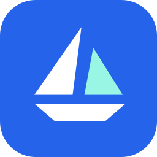

<p align="center"></p>
<h1 align="center">同舟 Tongzhou</h1>
<p align="center"><strong>整合模型、知识与会话，一个本地工作台。</strong><br/>Windows · macOS · 开源 · 本地优先</p>
<p align="center"><a href="https://github.com/OrenZhang/tongzhou/releases">版本发布</a> · <a href="https://github.com/OrenZhang/tongzhou/issues">问题反馈</a> · <a href="CONTRIBUTING.md">参与贡献</a></p>

同舟是一个开源、本地优先的 AI 工作台，整合模型服务与订阅、本地知识库、连续会话和远程消息入口，覆盖日常问答、资料整理、内容创作和项目开发。

你可以在同一个会话中切换模型、继续任务，把值得保留的资料和经验沉淀到自己的智库，再通过飞书、企业微信等入口查看和管理会话。

## 整合的目标

- **自己的知识，自己维护**：无需安装 Obsidian 等笔记应用，在同舟内管理资料、笔记、整理文档与会话记忆。Agent 按需检索、提炼和补充知识，保留来源与版本，供你核对、修正和复用。
- **不同模型，同一份会话**：集中接入已适配的模型 API、订阅套餐与本地模型服务，在同一个会话里选择模型和账号，接续已有上下文与任务。
- **多个入口，同一个工作台**：桌面端与飞书、企业微信等机器人连接本地会话，在授权范围内查看进度、继续任务和接收通知。

整合围绕可持续使用的会话和知识展开：模型可以更换，任务与资料继续积累；新增服务通过适配接入，沿用同舟的权限和管理流程。

## 核心能力

- **多模型接入与切换**：支持 ChatGPT、Kimi Code、MiniMax Code 账号接入，以及 OpenAI 兼容接口、Anthropic、Gemini 和本地模型服务；同一会话可切换模型，保留历史继续任务。
- **本地智库与知识沉淀**：统一管理文档、笔记、知识与记忆，支持目录、双向链接、实体关系、来源核对和修订历史；Agent 按需检索和整理，后台从已完成会话中提炼值得保留的经验。
- **远程会话管理**：飞书、企业微信和钉钉机器人适配会话列表、进度查询、会话选择、新建、继续、停止、重命名与归档；通知可通过这些平台和邮件发送。
- **连续会话**：支持中途补充、停止后继续、图片与文件附件、长文本转文件和历史上下文整理。
- **项目开发**：文件搜索、代码预览、Git 变更审阅、命令执行与项目说明维护，文件和代码位置可直接引用到会话。
- **Agent 与插件**：自定义 Agent、并行分析，接入 MCP 和 Skills；按需启用浏览器、电脑控制和客户端管理能力。
- **本地数据与管理**：会话、知识和配置保存在本地，凭据加密存储；支持备份恢复、权限设置、浅色/深色主题及字体调整。

## 当前范围

目前处于开发预览阶段。上述能力已有实现，不同平台、模型和第三方服务仍需分别验证，详见 [实施状态](docs/IMPLEMENTATION_STATUS.md) 与 [验证记录](docs/VALIDATION.md)。

- **模型与订阅**：按服务商提供的接口、授权方式和账号权益接入，不保证任意订阅套餐都可直接调用。切换模型在后续轮次生效，当前运行中的任务使用本轮已确定的模型和账号。
- **知识与模型调用**：知识保存在本地，Agent 生成的知识与记忆保留待核对状态；使用云端模型时，用于任务的消息和检索内容会发送给相应模型服务。
- **远程管理**：需要本地客户端在线、网络可用，并配置机器人身份与会话范围。当前远程命令尚不提供模型选择或工具审批入口；需要选择模型或批准操作时回到桌面端。客户端退出或电脑休眠后，不提供全天候中继。

## 快速开始

准备 Node.js **22.19+（22 LTS）**、npm 和 Git，然后运行：

```bash
git clone https://github.com/OrenZhang/tongzhou.git
cd tongzhou
npm ci
npm run dev
```

启动后：

1. 在 **设置 → 模型** 中添加模型连接或登录已适配的订阅账号，在会话中选择模型开始聊天。
2. 在 **智库** 中导入资料或新建笔记，按需让 Agent 整理、检索和沉淀知识。
3. 在 **设置 → 连接中心** 中配置服务账号、通知和机器人，选择允许访问的用户与会话范围。
4. 在 **插件** 中启用所需的 MCP、Skills、浏览器或电脑控制能力；需要开发代码时打开项目。

同一 API 网关可在模型连接的 **高级：按模型设置接口协议** 中为个别模型选择 Chat Completions、Responses、Anthropic 或 Gemini，其余模型继承连接协议。按网关实际支持情况配置；保存后从下一轮生效，请求失败不会自动切换协议重发。**分项连接检测** 可选择具体模型验证推理与工具参数。API Key 保持加密保存，在本机界面点击查看／隐藏或复制；留空保存会保留已有密钥。

在 **设置 → 模型 → 编辑连接 → 高级：模型思考** 中，可配置思考强度 `low / medium / high / xhigh / max`。官方账号按模型目录校验支持的档位；API 连接以服务实际支持为准，未指定时保持 `medium` 默认。配置保存后从下一轮生效，实际档位记录在 Run 中。内置 Codex App Server 固定为 `0.162.1`，负责工具循环、原生上下文压缩与线程恢复；有原生计划事件时在本轮处理过程展示步骤。

在同一个编辑连接窗口的 **自动模型路由** 中配置模型池，可引用其他连接的模型，为通用、编程、文档、图片场景及问答、规划、执行、检查、总结阶段指定模型与思考强度。保留一项“通用默认 / 所有阶段”作为默认；更具体的规则优先，同优先级按列表顺序。会话选择 **自动路由** 后，每轮开始使用本地规则识别场景和阶段，也可手动指定阶段；简短的“继续”沿用上一轮场景和阶段。已停用、已移除或未配置密钥的 API 连接会跳过；图片上下文只使用明确勾选支持图片的候选。官方账号仍需完成登录，服务端账号权益以实际调用为准。工具循环、追问补充和完成检查保持本轮模型与思考强度，下轮重新选择。选择具体模型即可固定模型，配置模型池不会改变原有固定模型请求。此路由不额外调用分类模型、不插入任务提示词，也不在服务报错或工具执行后自动换模型重发。

任务支持结构化追问，可选择选项或填写补充内容；完全开放权限不会代替你回答。官方账号及 GPT-6 原生 Responses 连接支持原生子 Agent，可在处理过程查看状态、停止和继续。执行过程显示核心报告的模型、思考强度、压缩次数及父子任务用量，进度说明与最终答复分别展示。

macOS 的同舟密钥改为本地加密保存，不再调用系统钥匙串。旧版钥匙串密文会保留，但不会自动解锁或迁移；标为需要更新的连接请重新填写 Token，OAuth 插件请重新登录。重新保存后，日常读取密钥无需系统密码。加密密钥位于应用数据目录的 `local-secret.key`，随手动复制数据目录一同保留；应用导出的备份仍不包含认证凭据。

插件列表使用紧凑卡片，仅展示图标、名称、类型和启用开关。点击名称进入统一详情页，按插件类型展示连接与认证、本机账号、依赖安装、工具列表或技能指令；返回列表保留搜索与类型筛选。渠道属于始终可用的内置应用，其具体账号开关在渠道管理中操作。

时间和系统信息查询已并入核心工具，按需调用，不再以“系统环境”MCP 插件展示或启动额外进程。已有配置会在启动时自动迁移。

“网页搜索与读取 · 内置”在新配置中默认开启，已有用户手动设置保持不变。`web_search` 通过必应公开 RSS 搜索返回关键词结果，无需模型账号或 API Key；`fetch_page` 读取指定网址正文。搜索请求允许必应国内站点跳转，遇到网络错误、验证页或响应格式变化时会明确报错，不会当作没有结果。该公开搜索入口不提供商业 API 的可用性保证。

在 **插件 → 内置插件 → MCP** 中配置 MiniMax 多媒体、MiniMax 搜索与图片理解，以及 Kimi 搜索与网页读取。默认关闭，点击插件名称进入详情，优先选择 **使用同舟套餐账号**，绑定模型页面中已登录并启用的对应账号，不必复制 API Key 或安装 Python。调用时读取最新授权，模型与插件共享令牌刷新；账号停用、移除或退出后不可继续调用。凭据仅留在主进程，固定发往官方套餐接口，不传给 MCP 子进程。

- **MiniMax 套餐模式**：搜索与图片理解提供联网搜索、HTTPS 图片理解；多媒体提供图片生成、语音合成、音色查询、视频生成和查询，返回媒体 URL。适配已锁定的 `@minimax-ai/code` 0.4.12 套餐接口。声音克隆、声音设计和本机播放仍使用 API Key 模式；工具能力、额度以服务端账号套餐为准。
- **MiniMax API Key 模式**：使用[官方多媒体 MCP](https://github.com/MiniMax-AI/MiniMax-MCP) `minimax-mcp==0.0.19` 和[官方 Coding Plan MCP](https://github.com/MiniMax-AI/MiniMax-Coding-Plan-MCP) `minimax-coding-plan-mcp==0.0.5`。仅此模式需安装 [uv](https://docs.astral.sh/uv/getting-started/installation/)，在详情中安装／修复依赖或指定 uvx 路径。密钥加密保存，区域需与密钥一致；切换套餐模式会保留已有密钥供以后切回使用。
- **Kimi 搜索与网页读取**：同舟适配 [Kimi Code 的服务接口](https://www.kimi.com/en/help/kimi-code/cli-config-files)，可复用同舟 Kimi 登录，也可单独配置 Kimi Code API Key，无需 Python。套餐模式只允许匹配的官方服务端点与授权引用。

保存并检查连接验证凭据读取和工具目录，不调用付费生成接口，也不代表服务端已验证套餐权限或额度。生成请求失败不会自动重发，避免重复消耗额度。

Windows 上点击窗口右上角的关闭按钮会隐藏到系统托盘，后台会话与机器人连接继续运行。点击托盘中的同舟图标，或右键选择 **打开同舟**，即可恢复窗口；右键选择 **退出同舟** 才会完全退出客户端。

在 Windows 和 macOS 的 **设置 → 电源与睡眠** 中，可开启 **接通电源时保持唤醒**：阻止空闲自动睡眠，同时允许屏幕熄灭。仅在接通电源时生效，拔电后暂停，退出同舟后释放。另可开启 **接通电源时合盖不睡眠**，关闭功能或退出后恢复原设置：Windows 只临时修改当前电源计划的交流电合盖动作，不更改电池策略；macOS 无需外接显示器，但每次启动同舟后需重新开启合盖模式并通过系统管理员授权，此模式会临时禁用系统睡眠（包括手动睡眠），辅助进程监测拔电与应用退出后恢复。异常中断的恢复记录会保留，失败时设置页显示重试入口。合盖运行时请保持散热通畅。

GitHub 和 GitLab 的认证统一在 **插件 → 内置插件** 管理，选择 **Token 配置** 或 **OAuth2 授权**。连接中心只管理独立浏览器登录、渠道通知、机器人和网络，不再提供 GitHub/GitLab 账号配置入口；已有账号数据保留，可在插件的 Token 来源中复用。

- **GitHub**：Token 和 OAuth2 均使用官方远程 MCP。OAuth2 点击 **使用 GitHub 登录**，在 GitHub 官方页面输入界面显示的验证码并授权；普通用户无需配置 Client ID/Client Secret。应用身份由同舟维护者在构建时配置，支持授权保存、令牌刷新和退出；维护者配置见 [GitHub 登录](docs/GITHUB_LOGIN.md)。可点击 **检测本地账号** 识别 Git 凭据或 GitHub CLI 当前登录，再点击 **使用并启用**。同舟重新验证身份及 MCP 连接后加密保存，检测结果仅展示账号和来源；手动 Token 的 **保存并检查** 同样验证账号和工具连接。
- **GitLab**：填写 GitLab.com 或自建实例 HTTPS 根地址。Token 模式使用官方 REST API，无需开启 MCP；**保存并检查** 验证身份与项目 API，读取通常需要 `read_api`，写操作需要 `api`，并受项目权限限制。会话通过 `gitlab_api_read` / `gitlab_api_write` 调用实例上的项目、仓库、Issue、Merge Request 和 CI/CD API，写操作遵循会话权限。OAuth2 点击 **使用 GitLab 登录**，在所填实例的官方页面登录授权，授权加密保存在本机，普通用户无需填写 Client ID / Client Secret。此方式通过官方 MCP 自动注册 OAuth 应用，要求实例支持并开启 MCP 和应用自动注册；管理员关闭自动注册或实例不支持时，可改用 Token 配置。插件卡片与 Token 配置弹窗均支持本地 Git / glab 检测，**使用并配置** 保存 Token 账号；切换地址清除旧检测结果，不将普通 Token 当成 MCP OAuth 授权。

认证依据：[GitHub 官方 MCP 接入](https://github.com/github/github-mcp-server/blob/main/docs/host-integration.md) · [GitLab REST API 认证](https://docs.gitlab.com/api/rest/authentication/) · [GitLab 官方 MCP](https://docs.gitlab.com/user/model_context_protocol/mcp_server/)。仅保存凭据会显示待检查，通过连接检查后才显示已验证。

**Figma** 支持远程浏览器授权和桌面 MCP，应用配置由同舟管理，用户无需填写 Client ID / Secret。同舟已申请远程 MCP 全部读写工具接入，尚未获批；当前可连接 Figma 桌面 MCP 读取设计，FigJam 图表生成需要远程服务。插件详情提供授权范围、工具读写分类及只读配置校验；连接检查不会执行写操作，也不代表拥有所有文件或项目的读写权限。详见 [Figma 连接与 MCP 权限](docs/FIGMA_MCP.md)。

智库的使用流程、来源核对与本地数据说明见 [本地智库与每日记忆](docs/KNOWLEDGE-CENTER.md)。

## 开发架构

客户端使用 Electron + React + TypeScript。Cordis 在应用入口组合内置服务，管理依赖、接口与资源生命周期；业务模块与渠道通过独立任务接口提交工作。任务调度、消息记录、账号认证和 Codex 执行适配分别维护自己的状态，执行适配器管理引擎进程与线程缓存，本地资料使用 SQLite 保存。界面按功能管理状态，App 组合页面与导航。当前边界见 [架构设计](docs/ARCHITECTURE.md) 和 [代码目录](docs/CODE_STRUCTURE.md)，后续仓储与宿主解耦计划见 [架构演进](docs/ARCHITECTURE_TARGET.md)。

## 了解更多

[贡献指南](CONTRIBUTING.md) · [架构设计](docs/ARCHITECTURE.md) · [代码目录](docs/CODE_STRUCTURE.md) · [发布流程](docs/RELEASING.md) · [实际开发示例](examples/miniapp-admin/README.md)

欢迎通过 [Issues](https://github.com/OrenZhang/tongzhou/issues) 提交问题和建议，也欢迎贡献代码。

采用 [Apache-2.0](LICENSE) 许可证。第三方组件说明见 [NOTICE](NOTICE)。
